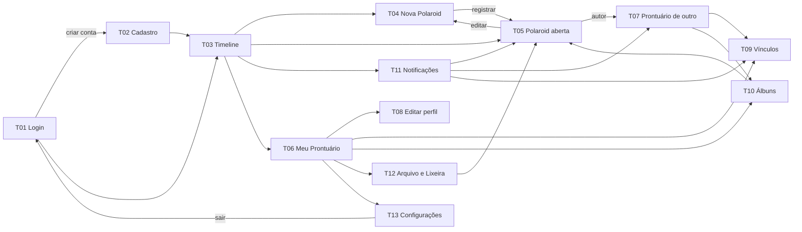
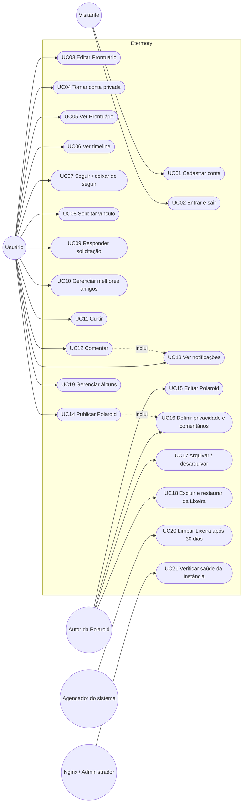
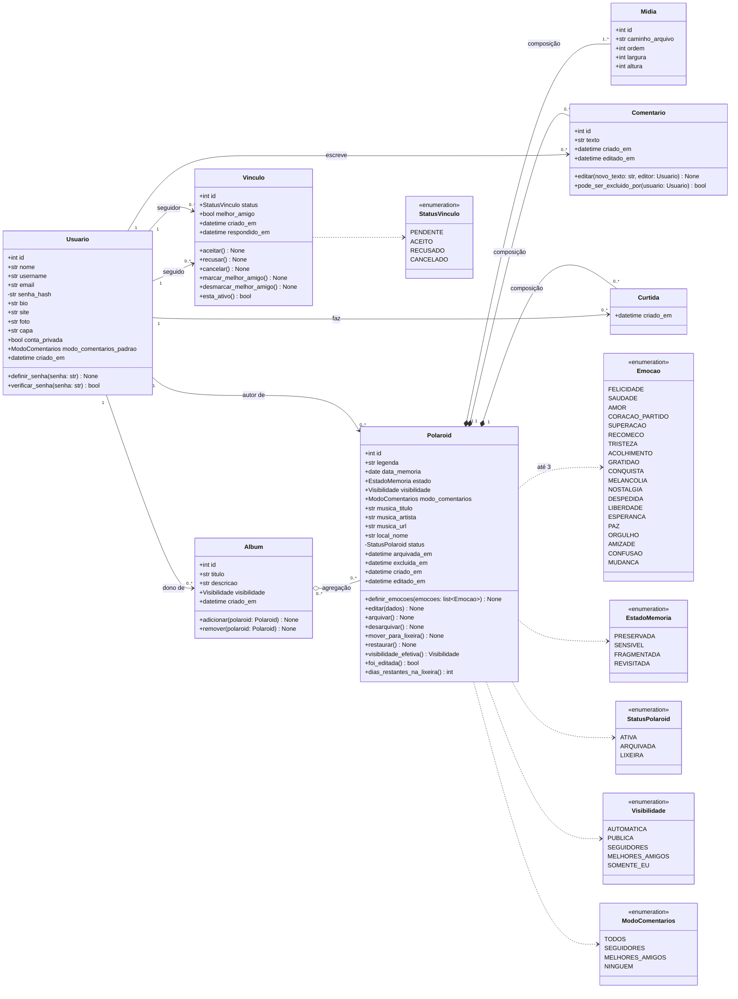
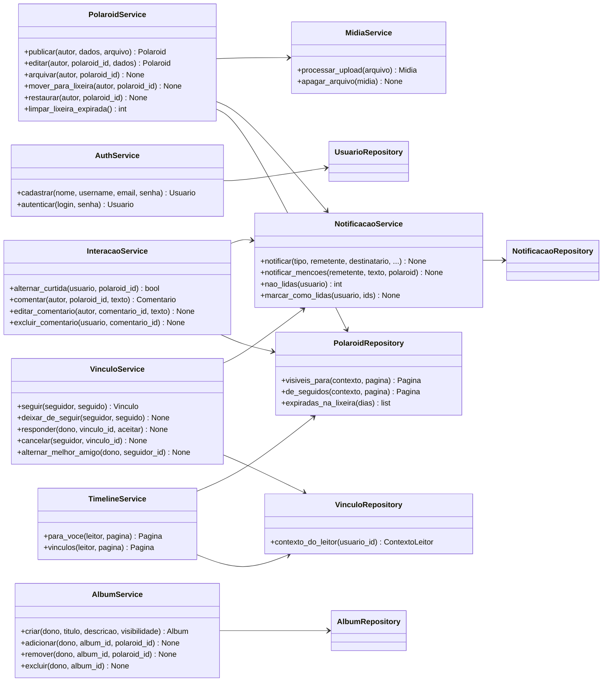
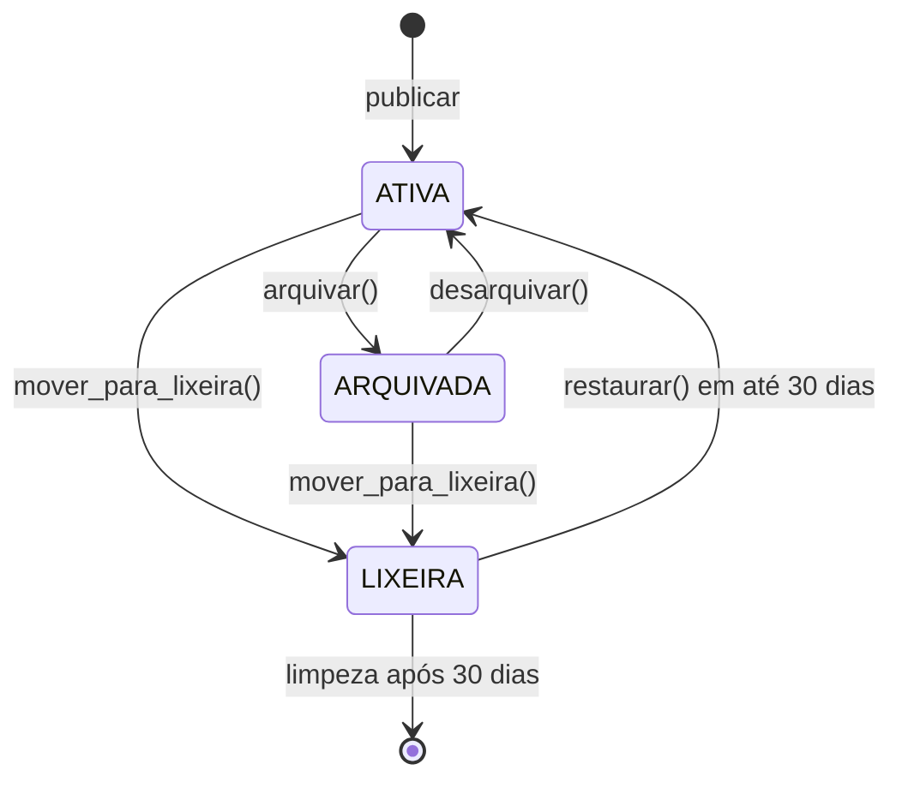
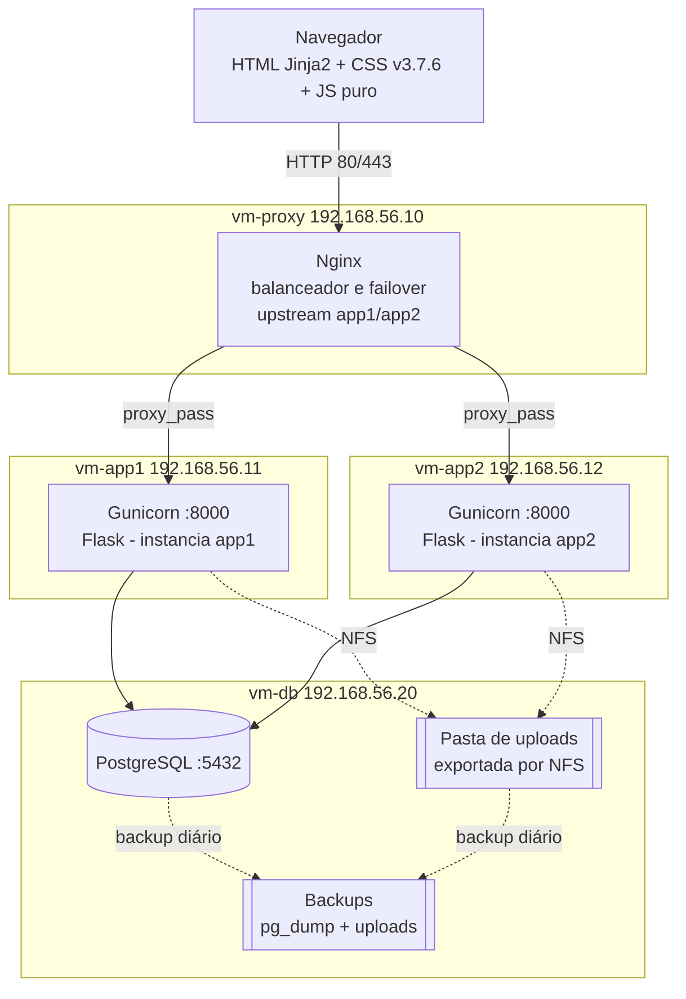
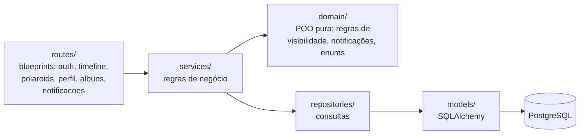
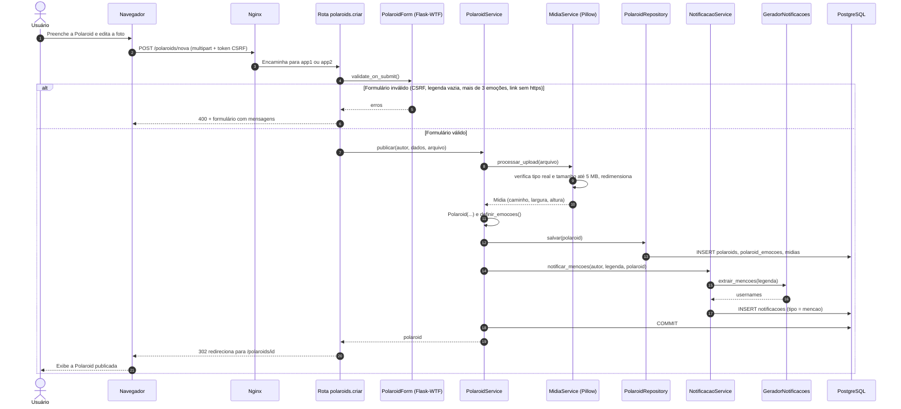

# Etermory — Documentação Técnica V1 (Planejamento)

> *"Memórias que permanecem."*

---

## 1. Capa

| Campo | Valor |
|---|---|
| Projeto | **Etermory** — rede social de memórias |
| Disciplina | [PREENCHER] |
| Professor(a) | [PREENCHER] |
| Instituição / Turma | [PREENCHER] |
| Versão do documento | **V1 — Planejamento** (1.0) |
| Data | 16/10/2026 |
| Repositório | https://github.com/Ardyson25/etemory |

### Integrantes e papéis

| Integrante | Papel | Foco principal |
|---|---|---|
| [PREENCHER] | Product Owner e documentação | Requisitos, backlog e consolidação da V1 à V4 |
| [PREENCHER] | Scrum Master e Git | Sprints, quadro de tarefas, revisão de pull requests |
| [PREENCHER] | Back-end 1 | Modelos, classes de domínio e regras de negócio |
| [PREENCHER] | Back-end 2 | Rotas, autenticação, banco e migrações |
| [PREENCHER] | Front-end | Templates Jinja2, CSS da v3.7.6 e protótipo |
| [PREENCHER] | Testes (QA) | pytest, casos de teste e relatório de testes |
| [PREENCHER] | Infraestrutura | VMs, Linux, Nginx, systemd, firewall, backup e failover |

---

## 2. Introdução

### 2.1 Problema

As redes sociais atuais são feitas para o consumo rápido: o conteúdo some no feed em poucas horas, é medido por números e raramente guarda o **contexto emocional** de um momento — o que a pessoa sentia, que música tocava, onde estava. Além disso, o controle de privacidade costuma ser por conta inteira, e não por lembrança.

### 2.2 Objetivo

Desenvolver o **Etermory**, uma aplicação web em **Python (Flask)**, construída com **Programação Orientada a Objetos**, em que cada memória é registrada como uma **Polaroid** com foto, legenda, data, emoções, estado da memória, música e local, e com controle de privacidade **por Polaroid**.

O projeto também cobre a modelagem, a publicação online e a infraestrutura Linux com **failover**, conforme as cinco fases do enunciado.

### 2.3 Público-alvo

- Jovens e adultos que querem guardar e compartilhar lembranças com um círculo de confiança.
- Pessoas que preferem um ambiente mais íntimo e menos voltado a métricas.
- Usuários que querem decidir, lembrança por lembrança, quem pode ver cada uma.

### 2.4 Visão do produto

> Para pessoas que querem preservar momentos importantes com contexto emocional, o **Etermory** é uma rede social de memórias que trata cada lembrança como um **Registro de Memória** (Polaroid), organizado num **Prontuário** pessoal e compartilhado por **Vínculos**. Diferente das redes de feed rápido, o Etermory valoriza a permanência, a emoção e a privacidade granular.

A identidade usa a linguagem de uma **"clínica de memórias"**: Registro de Memória, Prontuário, Vínculos, Arquivo Pessoal e Lixeira. A paleta é **vinho `#8C1A11`** e **creme `#FBF2D0`**, com tema claro e escuro. A Polaroid tem a mesma cor do fundo e se destaca por um relevo sutil.

### 2.5 Relação com a versão existente (v3.7.6)

Já existe um protótipo funcional (v3.7.6) em HTML, CSS e JavaScript puro, com 20 páginas e cerca de 12 mil linhas, que usa Firebase (login e Firestore), Cloudinary e Firebase Hosting. Ele **não tem back-end em Python** e por isso não serve como entrega. Esta versão **refaz o back-end em Python** e reaproveita:

| Reaproveitado da v3.7.6 | Não reaproveitado |
|---|---|
| CSS da pasta `css/` (consolidado), ícones e estrutura HTML das telas, convertida em templates Jinja2 | `firebase.js`, `media.js` e qualquer código que acesse Firebase ou Cloudinary (apontam para os dados reais do app publicado) |
| `image-editor.js` (recorte, zoom, girar e formatos de foto), que é só front-end | Regras escritas no `firestore.rules`, **como código** (viram serviços e classes Python) |
| Regras de negócio do `firestore.rules` e do JavaScript (seção 6) | Listas duplicadas dentro dos documentos (`followers`, `likedBy`, `allowedViewerIds`) |
| Telas atuais como base do protótipo (seção 9) | |

---

## 3. Escopo

### 3.1 Dentro do escopo (essencial — pronto até o fim da Fase 2)

1. **Contas:** cadastro (nome, @username, e-mail e senha), login, logout, edição de perfil (nome, bio, foto, capa) e conta privada.
2. **Polaroids:** criar, editar e excluir, com foto, legenda, data da memória, até 3 emoções, estado da memória, música (título, artista, link do Spotify) e local (nome). Polaroid editada mostra **"Editado"**.
3. **Privacidade por Polaroid:** Automática, Pública, Seguidores, Melhores amigos ou Só eu.
4. **Vínculos:** seguir e deixar de seguir, solicitação para conta privada, melhores amigos, listas de seguidores e seguindo.
5. **Timeline:** abas "Para você" e "Vínculos", da mais recente para a mais antiga, com paginação.
6. **Interações:** curtir e descurtir; comentar, editar e excluir o próprio comentário; controle de quem pode comentar.
7. **Notificações:** curtida, comentário, novo seguidor, solicitação de vínculo, solicitação aceita e menção com @; contador de não lidas e marcar como lida. **Sem tempo real**: atualizam ao carregar a página.
8. **Álbuns:** criar (público ou privado), adicionar e remover Polaroids, excluir o álbum.
9. **Arquivo e Lixeira:** arquivar e desarquivar; excluir manda para a Lixeira; restaurar em até 30 dias.

**Emoções disponíveis (20):** Felicidade, Saudade, Amor, Coração partido, Superação, Recomeço, Tristeza, Acolhimento, Gratidão, Conquista, Melancolia, Nostalgia, Despedida, Liberdade, Esperança, Paz, Orgulho, Amizade, Confusão e Mudança.

**Estados da memória:** Preservada (padrão), Sensível, Fragmentada e Revisitada.

### 3.2 Se der tempo

Explorar (busca de pessoas e de Polaroids por legenda, emoção, música e local); Salvos privados; reações emocionais (Amor, Nostalgia, Saudade, Felicidade e Superação); fixar até 3 Polaroids no perfil; mapa de memórias (Leaflet + OpenStreetMap); exportar meus dados em JSON; bloquear e denunciar usuários.

### 3.3 Fora do escopo e justificativa

| Recurso | Motivo |
|---|---|
| Chat e mensagens diretas | Exige tempo real (WebSocket) |
| Lapses (stories de 24 h) | Mídia efêmera e pesada; exige rotinas extras de expiração e armazenamento |
| Indicador "digitando" e presença online | Exige tempo real (WebSocket) |
| Áudio e vídeo | Mídia pesada: armazenamento, transcodificação e banda |
| Modo offline (PWA) | Sincronização e conflitos no cliente; foge do foco no back-end |
| Login com Google | Depende de serviço externo; o foco é a autenticação própria com hash |
| "Neste dia" | Recurso de engajamento sem conceito novo de POO |

**Justificativa geral:** esses recursos dependem de **tempo real (WebSocket)** ou de **mídia pesada**, complicam muito o servidor e o **failover da Fase 4** (conexões persistentes não trocam de instância com facilidade) e **não acrescentam conceitos de POO** ao que o projeto já demonstra.

---

## 4. Requisitos funcionais

Prioridade **MoSCoW**: **M** = Must (obrigatório), **S** = Should (importante), **C** = Could (se der tempo), **W** = Won't (não será feito agora).

### 4.1 Contas e perfil

| ID | Requisito | Prioridade | Regras |
|---|---|---|---|
| RF01 | O sistema deve permitir o cadastro com nome, @username, e-mail e senha. | M | RN12 |
| RF02 | O sistema deve permitir login com e-mail (ou @username) e senha, e logout. | M | RN01 |
| RF03 | O usuário deve poder editar nome, bio, site, foto de perfil e capa. | M | RN17, RN18 |
| RF04 | O usuário deve poder tornar a conta privada ou pública. | M | RN03, RN07 |
| RF05 | O sistema deve exibir o Prontuário (perfil) próprio e de outros usuários, com contadores e grade de Polaroids visíveis ao leitor. | M | RN02, RN04 |
| RF06 | O usuário deve poder definir o modo de comentários padrão das novas Polaroids. | S | RN08 |

### 4.2 Polaroids

| ID | Requisito | Prioridade | Regras |
|---|---|---|---|
| RF07 | O usuário deve poder criar uma Polaroid com foto, legenda, data da memória, até 3 emoções, estado da memória, música (título, artista, link do Spotify) e local. | M | RN11, RN17, RN18 |
| RF08 | O usuário deve poder recortar, dar zoom, girar e escolher o formato da foto antes de publicar (`image-editor.js`). | S | RN18 |
| RF09 | O autor deve poder editar a Polaroid; a Polaroid editada exibe o selo "Editado". | M | RN11 |
| RF10 | O autor deve poder definir a visibilidade de cada Polaroid: Automática, Pública, Seguidores, Melhores amigos ou Só eu. | M | RN02, RN03 |
| RF11 | O autor deve poder definir quem comenta em cada Polaroid: todos que podem ver, seguidores, melhores amigos ou ninguém. | M | RN08 |
| RF12 | O autor deve poder excluir a Polaroid, que vai para a Lixeira. | M | RN14 |

### 4.3 Vínculos

| ID | Requisito | Prioridade | Regras |
|---|---|---|---|
| RF13 | O usuário deve poder seguir e deixar de seguir outro usuário de conta pública. | M | RN05, RN15 |
| RF14 | Para conta privada, o sistema deve criar uma solicitação de vínculo que o dono aceita ou recusa, e que o solicitante pode cancelar enquanto pendente. | M | RN07 |
| RF15 | O usuário deve poder marcar e desmarcar seguidores como melhores amigos. | M | RN06 |
| RF16 | O sistema deve exibir as listas de seguidores e seguindo de um usuário. | M | RN02 |

### 4.4 Timeline

| ID | Requisito | Prioridade | Regras |
|---|---|---|---|
| RF17 | A aba "Para você" deve mostrar todas as Polaroids que o usuário pode ver, da mais recente para a mais antiga. | M | RN01–RN05 |
| RF18 | A aba "Vínculos" deve mostrar só as Polaroids de quem o usuário segue. | M | RN02, RN05 |
| RF19 | As timelines devem ser paginadas. | M | — |

### 4.5 Interações

| ID | Requisito | Prioridade | Regras |
|---|---|---|---|
| RF20 | O usuário deve poder curtir e descurtir uma Polaroid sem recarregar a página. | M | RN10 |
| RF21 | O usuário deve poder comentar numa Polaroid que pode ver, respeitando o modo de comentários. | M | RN08, RN09 |
| RF22 | O autor do comentário deve poder editá-lo; ele ou o dono da Polaroid podem excluí-lo. | M | RN09 |

### 4.6 Notificações

| ID | Requisito | Prioridade | Regras |
|---|---|---|---|
| RF23 | O sistema deve gerar notificações de curtida, comentário, novo seguidor, solicitação de vínculo, solicitação aceita e menção com @. | M | RN15, RN16 |
| RF24 | O sistema deve exibir a lista de notificações, o contador de não lidas e permitir marcar uma ou todas como lidas. | M | — |

### 4.7 Álbuns

| ID | Requisito | Prioridade | Regras |
|---|---|---|---|
| RF25 | O usuário deve poder criar álbuns públicos ou privados, com título e descrição. | M | RN13 |
| RF26 | O usuário deve poder adicionar e remover as próprias Polaroids de um álbum. | M | RN13 |
| RF27 | O usuário deve poder excluir um álbum sem excluir as Polaroids. | M | RN13 |

### 4.8 Arquivo e Lixeira

| ID | Requisito | Prioridade | Regras |
|---|---|---|---|
| RF28 | O autor deve poder arquivar e desarquivar Polaroids e ver o Arquivo Pessoal. | M | RN04 |
| RF29 | O autor deve poder ver a Lixeira, com os dias restantes, e restaurar uma Polaroid em até 30 dias. | M | RN04, RN14 |
| RF30 | O sistema deve apagar de vez, por rotina agendada, as Polaroids com mais de 30 dias na Lixeira, junto com comentários, curtidas e fotos. | M | RN14 |

### 4.9 Operação

| ID | Requisito | Prioridade | Regras |
|---|---|---|---|
| RF31 | O sistema deve ter a rota `GET /saude`, que responde `{"status": "ok", "instancia": "<nome>"}`. | M | — |

### 4.10 Se der tempo

| ID | Requisito | Prioridade |
|---|---|---|
| RF32 | Explorar: buscar pessoas por nome ou @ e Polaroids por legenda, emoção, música e local. | S |
| RF33 | Salvos privados. | C |
| RF34 | Reações emocionais (Amor, Nostalgia, Saudade, Felicidade, Superação). | C |
| RF35 | Fixar até 3 Polaroids no perfil. | C |
| RF36 | Mapa de memórias (Leaflet + OpenStreetMap). | C |
| RF37 | Exportar meus dados em JSON. | C |
| RF38 | Bloquear e denunciar usuários. | C |
| RF39 | Chat, Lapses, presença online, áudio e vídeo, PWA, login com Google, "Neste dia". | W |

---

## 5. Requisitos não funcionais

| ID | Categoria | Requisito |
|---|---|---|
| RNF01 | Segurança | Senhas guardadas só como hash (Werkzeug `generate_password_hash`); nunca em texto puro nem em log. |
| RNF02 | Segurança | Proteção CSRF (Flask-WTF) em todos os formulários e requisições `POST` feitas por JavaScript. |
| RNF03 | Segurança | Acesso ao banco só pelo ORM (SQLAlchemy), com parâmetros, para evitar SQL injection; saída escapada pelo Jinja2 contra XSS. |
| RNF04 | Segurança | Segredos (`SECRET_KEY`, senha do banco) só em `.env`, fora do Git; o repositório tem um `.env.example`. |
| RNF05 | Segurança | Cookie de sessão `HttpOnly` e `SameSite=Lax`; `Secure` em produção com HTTPS. |
| RNF06 | Segurança | Upload validado pelo conteúdo (Pillow), não só pela extensão; arquivos salvos com nome gerado (UUID). |
| RNF07 | Segurança | Toda rota que altera ou mostra conteúdo exige login e checa permissão no serviço; acesso negado retorna 403 ou 404. |
| RNF08 | Desempenho | Timeline paginada (20 Polaroids por página), com índices em `polaroids (autor_id, criado_em)`, `notificacoes (destinatario_id, lida)` e `vinculos (seguido_id, status)`. |
| RNF09 | Desempenho | Imagens redimensionadas no servidor (maior lado com até 1600 px, qualidade 85) para reduzir espaço e tempo de carga. |
| RNF10 | Usabilidade | Interface em português do Brasil, com a identidade da "clínica de memórias", mensagens de erro claras e tema claro e escuro. |
| RNF11 | Responsividade | Telas usáveis de 360 px (celular) até desktop. |
| RNF12 | Acessibilidade | Texto alternativo nas imagens, contraste adequado na paleta vinho/creme e navegação por teclado nos formulários. |
| RNF13 | Disponibilidade | Duas instâncias da aplicação atrás do Nginx; a queda de uma não tira o site do ar. |
| RNF14 | Disponibilidade | Backup diário do banco e dos uploads, com 7 dias de retenção, cópia em outra máquina e restauração testada. |
| RNF15 | Manutenibilidade | Arquitetura em camadas (rotas → serviços → repositórios/modelos), PEP 8, type hints e nomes em português. |
| RNF16 | Manutenibilidade | Testes com pytest; meta de cobertura de 80% em `domain/` e `services/` e 70% no total. |
| RNF17 | Manutenibilidade | Todo código entra por pull request revisado, com commits no padrão definido na V2. |
| RNF18 | Compatibilidade | Versões atuais de Chrome, Firefox, Edge e Safari; Python 3.12+; PostgreSQL 16+; Ubuntu Server LTS. |
| RNF19 | Operação | Logs da aplicação em `/var/log/etermory`, com rotação (logrotate), além dos logs do Nginx e do systemd. |
| RNF20 | Portabilidade | Configuração por ambiente (desenvolvimento, teste, produção) por variáveis de ambiente. |

---

## 6. Regras de negócio

### 6.1 Regras herdadas da v3.7.6

| Código | Regra |
|---|---|
| RN01 | Só usuários logados veem conteúdo. O autor sempre vê as próprias Polaroids. |
| RN02 | Visibilidade: **Pública** = qualquer usuário logado, mesmo que a conta do autor seja privada; **Seguidores** = autor + seguidores aceitos; **Melhores amigos** = autor + quem ele marcou como melhor amigo; **Só eu** = apenas o autor. |
| RN03 | "Automática" vira Pública se a conta for pública e Seguidores se a conta for privada. |
| RN04 | Polaroid arquivada ou na Lixeira só aparece para o autor. |
| RN05 | Aceitar um seguidor não libera Polaroids "Melhores amigos" nem "Só eu". Deixar de seguir remove o acesso na hora. |
| RN06 | Melhor amigo precisa ser seguidor; deixar de seguir também o tira da lista. |
| RN07 | Solicitação de vínculo só existe para conta privada: fica pendente até o dono aceitar ou recusar, e quem pediu pode cancelar enquanto estiver pendente. Conta pública é seguida na hora. |
| RN08 | Para comentar é preciso poder ver a Polaroid e respeitar o modo de comentários dela: todos que podem ver, seguidores, melhores amigos ou ninguém. O autor sempre pode comentar. |
| RN09 | Comentário tem de 1 a 500 caracteres. Só o autor do comentário pode editá-lo; ele ou o dono da Polaroid podem excluí-lo. |
| RN10 | Uma curtida por usuário em cada Polaroid. |
| RN11 | A legenda é obrigatória; a Polaroid tem no máximo 3 emoções. |
| RN12 | @username é único, tem de 3 a 24 caracteres e usa só letras minúsculas, números, ponto e sublinhado. |
| RN13 | Título de álbum tem de 1 a 80 caracteres. Excluir o álbum não exclui as Polaroids dele. |
| RN14 | Excluir uma Polaroid manda para a Lixeira; após 30 dias ela é apagada de vez, junto com comentários, curtidas e fotos. |
| RN15 | Ninguém segue a si mesmo nem recebe notificação das próprias ações. |
| RN16 | Uma menção com @ na legenda ou no comentário gera notificação se o usuário existir. |
| RN17 | Links (Spotify, site do perfil) só aceitam endereços `https://`. |
| RN18 | Upload só de imagens JPEG, PNG ou WebP de até 5 MB, redimensionadas no servidor. |

### 6.2 Regras complementares

Ao transformar as regras em código, surgiram casos que a v3.7.6 não deixa claros. As regras abaixo completam a seção 6.1 e também viram código e testes.

| Código | Regra | Motivo |
|---|---|---|
| RC01 | Um álbum público só mostra ao leitor as Polaroids que ele pode ver pela RN02 e RN04. | Senão o álbum viraria um atalho para ver memórias privadas. |
| RC02 | A menção com @ só gera notificação se o mencionado puder ver a Polaroid. | Evita notificação com link para conteúdo bloqueado e vazamento de existência. |
| RC03 | Um usuário só adiciona a um álbum as próprias Polaroids. | Evita expor memórias de outros num álbum público. |
| RC04 | Ao mudar a conta de privada para pública, as solicitações pendentes são aceitas automaticamente. | Mantém a RN07 coerente: conta pública não tem solicitação. |
| RC05 | Polaroid "Automática" é recalculada sempre que for lida; se a conta mudar de pública para privada, ela passa a valer como Seguidores na hora. | Comportamento previsível e seguro para o autor. |
| RC06 | Ao recusar ou cancelar uma solicitação, o solicitante pode pedir de novo. | Evita bloqueio permanente sem a função de bloquear (fora do essencial). |

---

## 7. Histórias de usuário

Formato: **Como** \<papel\>, **quero** \<ação\>, **para** \<benefício\>. Critérios de aceitação em **Dado / Quando / Então**.

### HU01 — Cadastro (RF01)
**Como** visitante, **quero** criar uma conta com nome, @username, e-mail e senha, **para** começar a registrar minhas memórias.

- **Dado** que preenchi todos os campos com dados válidos, **quando** envio o formulário, **então** a conta é criada, a senha é salva como hash e entro logado na timeline.
- **Dado** que o @username já existe, **quando** envio o formulário, **então** vejo "Este @username já está em uso" e a conta não é criada.
- **Dado** que digitei o @username "Ana Maria!", **quando** envio, **então** vejo que só são aceitas letras minúsculas, números, ponto e sublinhado, de 3 a 24 caracteres.

### HU02 — Login e logout (RF02)
**Como** usuário, **quero** entrar e sair da minha conta, **para** acessar minhas memórias com segurança.

- **Dado** e-mail e senha corretos, **quando** faço login, **então** sou levado à timeline.
- **Dado** senha errada, **quando** faço login, **então** vejo "E-mail ou senha incorretos", sem dizer qual dos dois errou.
- **Dado** que não estou logado, **quando** acesso `/timeline`, **então** sou redirecionado para o login (RN01).

### HU03 — Editar Prontuário (RF03)
**Como** usuário, **quero** editar nome, bio, site, foto e capa, **para** que meu Prontuário me represente.

- **Dado** uma foto PNG de 2 MB, **quando** salvo, **então** ela é redimensionada e aparece no perfil.
- **Dado** um arquivo PDF ou uma imagem de 8 MB, **quando** salvo, **então** vejo o erro e nada muda (RN18).
- **Dado** o site `http://meusite.com`, **quando** salvo, **então** vejo que só endereços `https://` são aceitos (RN17).

### HU04 — Conta privada (RF04)
**Como** usuário, **quero** tornar minha conta privada, **para** escolher quem me segue.

- **Dado** que minha conta é privada, **quando** alguém clica em "Seguir", **então** é criada uma solicitação pendente, e não um vínculo aceito.
- **Dado** que minha conta é privada, **quando** um não seguidor abre meu Prontuário, **então** ele vê só as Polaroids Públicas (RN02).

### HU05 — Criar Polaroid (RF07, RF08)
**Como** usuário, **quero** registrar uma memória com foto, legenda, data, emoções, estado, música e local, **para** guardar o momento com o contexto emocional.

- **Dado** foto, legenda e até 3 emoções, **quando** publico, **então** a Polaroid aparece no topo do meu Prontuário e da timeline.
- **Dado** que não escrevi a legenda, **quando** publico, **então** vejo "A legenda é obrigatória" (RN11).
- **Dado** que tento marcar uma 4ª emoção, **quando** clico nela, **então** a interface impede e o servidor também rejeita (RN11).
- **Dado** que não escolhi estado, **quando** publico, **então** o estado é "Preservada".

### HU06 — Editar Polaroid (RF09)
**Como** autor, **quero** editar uma Polaroid, **para** corrigir ou completar a memória.

- **Dado** que sou o autor, **quando** salvo a edição, **então** a Polaroid mostra "Editado".
- **Dado** que não sou o autor, **quando** tento acessar a edição, **então** recebo 403.

### HU07 — Privacidade por Polaroid (RF10)
**Como** autor, **quero** escolher quem vê cada Polaroid, **para** controlar a exposição de cada memória.

- **Dado** uma Polaroid "Melhores amigos", **quando** um seguidor que não é melhor amigo abre o link, **então** ele recebe 404 (RN05).
- **Dado** uma Polaroid "Pública" numa conta privada, **quando** um usuário logado que não segue o autor a abre, **então** ele a vê (RN02).
- **Dado** uma Polaroid "Automática" numa conta privada, **quando** um não seguidor tenta vê-la, **então** ela é tratada como "Seguidores" e fica oculta (RN03).

### HU08 — Seguir (RF13)
**Como** usuário, **quero** seguir pessoas, **para** ver as memórias delas na aba Vínculos.

- **Dado** uma conta pública, **quando** clico em "Seguir", **então** o vínculo é aceito na hora e o dono recebe a notificação "novo seguidor".
- **Dado** que estou no meu próprio perfil, **então** o botão "Seguir" não aparece, e o servidor recusa a tentativa (RN15).
- **Dado** que deixo de seguir alguém, **então** perco na hora o acesso às Polaroids "Seguidores" e saio da lista de melhores amigos dele (RN05, RN06).

### HU09 — Solicitação de vínculo (RF14)
**Como** dono de conta privada, **quero** aceitar ou recusar solicitações, **para** decidir quem acompanha minhas memórias.

- **Dado** uma solicitação pendente, **quando** aceito, **então** o status vira ACEITO e o solicitante recebe "solicitação aceita".
- **Dado** uma solicitação pendente, **quando** recuso, **então** o status vira RECUSADO e nada é liberado.
- **Dado** que eu enviei a solicitação, **quando** clico em "Cancelar" antes da resposta, **então** o status vira CANCELADO (RN07).

### HU10 — Melhores amigos (RF15)
**Como** usuário, **quero** marcar seguidores como melhores amigos, **para** compartilhar memórias mais íntimas com eles.

- **Dado** um seguidor aceito, **quando** o marco, **então** ele passa a ver minhas Polaroids "Melhores amigos".
- **Dado** alguém que não me segue, **quando** tento marcá-lo, **então** o sistema recusa (RN06).

### HU11 — Listas de vínculos (RF16)
**Como** usuário, **quero** ver quem segue e quem é seguido por um perfil, **para** descobrir pessoas.

- **Dado** um perfil, **quando** abro "Seguidores" ou "Seguindo", **então** vejo só vínculos com status ACEITO.

### HU12 — Timeline (RF17, RF18, RF19)
**Como** usuário, **quero** uma timeline "Para você" e uma "Vínculos", **para** acompanhar as memórias que posso ver.

- **Dado** a aba "Para você", **então** vejo todas as Polaroids que posso ver, da mais recente para a mais antiga.
- **Dado** a aba "Vínculos", **então** vejo só as Polaroids de quem sigo (e as minhas).
- **Dado** que existem mais Polaroids que o tamanho da página, **quando** chego ao fim, **então** posso carregar a página seguinte.
- **Dado** uma Polaroid arquivada ou na Lixeira, **então** ela nunca aparece para outras pessoas (RN04).

### HU13 — Curtir (RF20)
**Como** usuário, **quero** curtir uma Polaroid, **para** demonstrar carinho pela memória.

- **Dado** que ainda não curti, **quando** clico no coração, **então** o contador sobe sem recarregar a página e o autor é notificado.
- **Dado** que já curti, **quando** clico de novo, **então** a curtida é removida (RN10).
- **Dado** que curto a minha própria Polaroid, **então** não recebo notificação (RN15).

### HU14 — Comentar (RF21)
**Como** usuário, **quero** comentar uma Polaroid, **para** conversar sobre a memória.

- **Dado** um comentário de 1 a 500 caracteres numa Polaroid que posso ver e cujo modo me permite comentar, **quando** envio, **então** ele aparece e o autor é notificado.
- **Dado** o modo "Ninguém", **então** o campo não aparece e o servidor recusa a tentativa — exceto para o autor (RN08).
- **Dado** um comentário com `@joao` e `@joao` existe, **então** ele recebe notificação de menção (RN16).

### HU15 — Editar e excluir comentário (RF22)
**Como** autor de um comentário, **quero** editá-lo ou excluí-lo, **para** corrigir o que escrevi.

- **Dado** que sou autor do comentário, **quando** edito, **então** o texto muda e mostra "Editado".
- **Dado** que sou o dono da Polaroid, **quando** excluo um comentário de outra pessoa, **então** ele é removido; mas não consigo editá-lo (RN09).

### HU16 — Notificações (RF23, RF24)
**Como** usuário, **quero** ver minhas notificações, **para** saber o que aconteceu com minhas memórias.

- **Dado** notificações não lidas, **quando** carrego qualquer página, **então** vejo o contador no menu.
- **Dado** a tela de notificações, **quando** clico em uma, **então** ela é marcada como lida e sou levado ao link dela.
- **Dado** "Marcar todas como lidas", **então** o contador zera.

### HU17 — Álbuns (RF25, RF26, RF27)
**Como** usuário, **quero** organizar Polaroids em álbuns, **para** agrupar memórias de um mesmo tema.

- **Dado** um título de 1 a 80 caracteres, **quando** crio o álbum, **então** ele aparece no meu Prontuário.
- **Dado** um álbum com Polaroids, **quando** o excluo, **então** as Polaroids continuam existindo (RN13).
- **Dado** um álbum privado, **quando** outra pessoa tenta abri-lo, **então** recebe 404.

### HU18 — Arquivo Pessoal (RF28)
**Como** autor, **quero** arquivar uma Polaroid, **para** tirá-la de vista sem apagá-la.

- **Dado** uma Polaroid ativa, **quando** arquivo, **então** ela some do perfil e da timeline e aparece só no meu Arquivo.
- **Dado** uma Polaroid arquivada, **quando** desarquivo, **então** ela volta ao lugar original pela data.

### HU19 — Lixeira (RF12, RF29, RF30)
**Como** autor, **quero** recuperar uma Polaroid excluída por engano, **para** não perder uma memória.

- **Dado** que excluí uma Polaroid, **então** ela aparece na Lixeira com "N dias restantes".
- **Dado** uma Polaroid na Lixeira há menos de 30 dias, **quando** restauro, **então** ela volta como ativa.
- **Dado** uma Polaroid na Lixeira há mais de 30 dias, **quando** a rotina de limpeza roda, **então** ela, seus comentários, curtidas e arquivos de foto são apagados (RN14).

### HU20 — Saúde da instância (RF31)
**Como** administrador de infraestrutura, **quero** a rota `/saude`, **para** o Nginx e o teste de failover saberem qual instância respondeu.

- **Dado** a instância app1 no ar, **quando** acesso `GET /saude`, **então** recebo `{"status": "ok", "instancia": "app1"}` com código 200, sem precisar de login.

---

## 8. Scrum

### 8.1 Papéis

| Papel Scrum | Quem | Responsabilidades |
|---|---|---|
| Product Owner | [PREENCHER] | Mantém e prioriza o backlog, aceita as histórias na Review, consolida a documentação. |
| Scrum Master | [PREENCHER] | Conduz as cerimônias, remove impedimentos, cuida do quadro e do fluxo de Git. |
| Time de desenvolvimento | Os 5 demais integrantes (Back-end 1, Back-end 2, Front-end, QA, Infraestrutura) | Estimam, desenvolvem, testam e documentam. PO e SM também fazem commits. |

### 8.2 Sprints e cerimônias

- **Duração:** 2 semanas por sprint.
- **Ferramenta:** **GitHub Projects**, porque liga cartões a issues, branches e pull requests no mesmo repositório que o professor vai avaliar. Colunas: *Backlog → A fazer (sprint) → Em andamento → Em revisão (PR) → Concluído*.

| Cerimônia | Quando | Duração | Saída |
|---|---|---|---|
| Sprint Planning | 1º dia da sprint | até 1 h | Meta da sprint e itens escolhidos |
| Daily | Assíncrona todo dia no grupo (o que fiz / o que vou fazer / impedimentos) + 2 encontros curtos por semana | 15 min | Impedimentos visíveis |
| Sprint Review | Último dia | 30 min | Demonstração do que está pronto; PO aceita ou devolve |
| Retrospectiva | Após a Review | 30 min | 1 a 3 ações de melhoria |
| Refinamento | Meio da sprint | 30 min | Itens seguintes detalhados e estimados |

### 8.3 Definition of Done (DoD)

Um item só está **Pronto** quando:

1. O código está no GitHub numa branch própria e entrou na `main` por pull request revisado por pelo menos 1 colega.
2. Segue PEP 8, tem type hints e comentários em português.
3. As regras de negócio envolvidas têm testes automatizados passando (`pytest`).
4. Formulários têm CSRF; entradas são validadas no servidor.
5. Nenhum segredo foi commitado.
6. A tela funciona no tema claro e escuro e em largura de celular.
7. A documentação da parte foi atualizada (seção correspondente da versão atual).
8. O PO aceitou na Sprint Review.

### 8.4 Backlog priorizado

Estimativa em **story points** (Fibonacci: 1, 2, 3, 5, 8, 13), relativa ao esforço e à incerteza.

| # | Item do backlog | HU / RF | MoSCoW | Pontos | Sprint |
|---|---|---|---|---|---|
| PBI01 | Estrutura do projeto: app factory, config, extensões, blueprints, `/saude`, `.env.example` | HU20 / RF31 | M | 3 | 2 |
| PBI02 | Templates base, CSS da v3.7.6 consolidado, tema claro/escuro | — | M | 5 | 2 |
| PBI03 | Modelo `Usuario` + cadastro com validações | HU01 / RF01 | M | 5 | 2 |
| PBI04 | Login e logout (Flask-Login) | HU02 / RF02 | M | 3 | 2 |
| PBI05 | `MidiaService`: validar, redimensionar e salvar imagens (Pillow) | RF07 / RN18 | M | 5 | 2 |
| PBI06 | Criar Polaroid (modelo, formulário, emoções, estado, música, local, editor de foto) | HU05 / RF07, RF08 | M | 8 | 2 |
| PBI07 | Editar perfil (nome, bio, site, foto, capa) | HU03 / RF03 | M | 3 | 2 |
| PBI08 | Regras de visibilidade em `domain/` (ABC + fábrica) com testes unitários | HU07 / RF10 | M | 8 | 3 |
| PBI09 | Editar Polaroid com selo "Editado" | HU06 / RF09 | M | 3 | 3 |
| PBI10 | Conta privada | HU04 / RF04 | M | 2 | 3 |
| PBI11 | Seguir e deixar de seguir | HU08 / RF13 | M | 3 | 3 |
| PBI12 | Solicitações de vínculo (enviar, aceitar, recusar, cancelar) | HU09 / RF14 | M | 5 | 3 |
| PBI13 | Melhores amigos | HU10 / RF15 | M | 3 | 3 |
| PBI14 | Prontuário próprio e de outros + listas de seguidores/seguindo | HU11 / RF05, RF16 | M | 5 | 3 |
| PBI15 | Timeline "Para você" com paginação | HU12 / RF17, RF19 | M | 8 | 3 |
| PBI16 | Timeline "Vínculos" | HU12 / RF18 | M | 3 | 3 |
| PBI17 | Curtir e descurtir (fetch + CSRF) | HU13 / RF20 | M | 3 | 4 |
| PBI18 | Comentários + regras de quem pode comentar (ABC + fábrica) | HU14 / RF11, RF21 | M | 5 | 4 |
| PBI19 | Editar e excluir comentário | HU15 / RF22 | M | 2 | 4 |
| PBI20 | Notificações: herança (STI), geração, menções | HU16 / RF23 | M | 8 | 4 |
| PBI21 | Tela de notificações e contador de não lidas | HU16 / RF24 | M | 3 | 4 |
| PBI22 | Álbuns | HU17 / RF25–RF27 | M | 5 | 4 |
| PBI23 | Arquivo Pessoal | HU18 / RF28 | M | 2 | 4 |
| PBI24 | Lixeira e restauração | HU19 / RF12, RF29 | M | 3 | 4 |
| PBI25 | Comando de limpeza da Lixeira (30 dias) | HU19 / RF30 | M | 3 | 4 |
| PBI26 | Configurações (privacidade, comentários padrão, tema) | RF04, RF06 | S | 2 | 4 |
| PBI27 | Relatório de testes e cobertura (V2) | — | M | 3 | 4 |
| PBI28 | Modelagem final do banco: DER, dicionário, índices, migrações (V3) | — | M | 5 | 5 |
| PBI29 | Publicação online (Flask + PostgreSQL gerenciado) (V3) | — | M | 5 | 5 |
| PBI30 | Explorar (busca) | RF32 | S | 8 | 5 |
| PBI31 | VMs, rede host-only/NAT, `/etc/hosts` | — | M | 5 | 6 |
| PBI32 | Usuários, grupos, SSH com chave, permissões | — | M | 3 | 6 |
| PBI33 | Deploy local, Gunicorn e `etermory.service` (systemd) | — | M | 3 | 6 |
| PBI34 | Nginx com upstream e failover | — | M | 5 | 6 |
| PBI35 | Firewall (ufw) | — | M | 2 | 6 |
| PBI36 | Scripts `deploy.sh`, `backup.sh`, `restore.sh`, `healthcheck.sh` | — | M | 5 | 6 |
| PBI37 | Backup diário + timers + restauração testada | — | M | 5 | 6 |
| PBI38 | Deploy pelo Git (hook ou script, reinício escalonado) | — | M | 3 | 6 |
| PBI39 | Logs: journald, Nginx, app, logrotate | — | M | 2 | 6 |
| PBI40 | Teste de indisponibilidade com evidências | — | M | 3 | 7 |
| PBI41 | Documentação final e apresentação | — | M | 5 | 7 |
| PBI42 | Salvos, reações, fixar, mapa, exportar JSON, bloquear/denunciar | RF33–RF38 | C | 26 | Se sobrar capacidade |

### 8.5 Plano de sprints

> A velocidade real do grupo só é conhecida após a Sprint 2. Os pontos abaixo são planejamento inicial.

| Sprint | Fase | Datas | Meta da sprint | Itens | Pontos | Entrega |
|---|---|---|---|---|---|---|
| 1 | 1 — Planejamento | [PREENCHER] | Requisitos, protótipo e modelagem aprovados | Documentação V1 | — | **V1** |
| 2 | 2 — Desenvolvimento | [PREENCHER] | "Consigo criar conta, entrar e publicar uma Polaroid" | PBI01–PBI07 | 32 | — |
| 3 | 2 — Desenvolvimento | [PREENCHER] | "Privacidade e vínculos funcionando na timeline" | PBI08–PBI16 | 40 | — |
| 4 | 2 — Desenvolvimento | [PREENCHER] | "Interações, notificações, álbuns e Lixeira; testes" | PBI17–PBI27 | 39 | **V2** |
| 5 | 3 — Implantação | [PREENCHER] | "Etermory publicado online com banco gerenciado" | PBI28–PBI30 | 18 | **V3** |
| 6 | 4 — Infraestrutura | [PREENCHER] | "Ambiente Linux com failover e backup" | PBI31–PBI39 | 33 | **V4** |
| 7 | 5 — Entrega | [PREENCHER] | "Failover demonstrado e apresentação pronta" | PBI40–PBI41 | 8 | **Final** |

---

## 9. Prototipação

O protótipo usa as telas da v3.7.6 como base visual. Cada tela será convertida num template Jinja2 com as **mesmas classes CSS**.

> Prints das telas: [PREENCHER COM EVIDÊNCIA — salvar em `docs/evidencias/prototipo/`].

### 9.1 Telas

| # | Tela | Rota | Conteúdo | Base na v3.7.6 |
|---|---|---|---|---|
| T01 | **Login** | `/entrar` | Logo e lema "Memórias que permanecem"; campos e-mail/@username e senha; botão Entrar; link "Criar conta"; mensagens de erro | [PREENCHER: arquivo] |
| T02 | **Cadastro** | `/cadastro` | Nome, @username (com dica das regras), e-mail, senha e confirmação; botão Criar conta; link "Já tenho conta" | [PREENCHER] |
| T03 | **Timeline** | `/` | Cabeçalho com logo, sino com contador de não lidas e avatar; abas "Para você" e "Vínculos"; lista de Polaroids (foto, legenda, data, emoções, estado, música, local, autor, curtidas, comentários, selo "Editado"); botão "Carregar mais"; botão flutuante "Nova memória" | [PREENCHER] |
| T04 | **Nova Polaroid** | `/polaroids/nova` | Upload da foto com editor (recorte, zoom, girar, formato); legenda; data da memória; seletor de até 3 emoções; estado da memória; música (título, artista, link Spotify); local; visibilidade; quem pode comentar; botão Registrar memória. A mesma tela serve para **editar** (`/polaroids/<id>/editar`) | [PREENCHER] |
| T05 | **Polaroid aberta** | `/polaroids/<id>` | Polaroid ampliada; autor e data; curtir; menu do autor (editar, arquivar, adicionar a álbum, excluir); lista de comentários com editar/excluir conforme RN09; campo de comentário (oculto se o modo não permitir) | [PREENCHER] |
| T06 | **Prontuário (meu perfil)** | `/@<username>` | Capa, foto, nome, @username, bio, site; contadores (memórias, seguidores, seguindo); botão Editar perfil; abas Memórias e Álbuns; atalhos para Arquivo e Lixeira | [PREENCHER] |
| T07 | **Prontuário de outro usuário** | `/@<username>` | Mesmo layout; botão conforme o estado do vínculo: **Seguir**, **Solicitado** (cancelar), **Seguindo** (deixar de seguir) ou **Melhor amigo**; conta privada sem vínculo mostra cadeado e só as Polaroids Públicas | [PREENCHER] |
| T08 | **Editar perfil** | `/perfil/editar` | Nome, bio, site (https), foto e capa com editor de imagem | [PREENCHER] |
| T09 | **Vínculos** | `/@<username>/seguidores`, `/seguindo`, `/vinculos/solicitacoes`, `/vinculos/melhores-amigos` | Listas com avatar, nome e ação; solicitações pendentes com Aceitar/Recusar; melhores amigos com marcar/desmarcar | [PREENCHER] |
| T10 | **Álbuns** | `/albuns`, `/albuns/<id>` | Grade de álbuns (capa, título, cadeado se privado); botão Novo álbum; tela do álbum com Polaroids, remover e excluir álbum | [PREENCHER] |
| T11 | **Notificações** | `/notificacoes` | Lista do mais recente para o mais antigo, com ícone por tipo, texto, tempo e destaque nas não lidas; botão "Marcar todas como lidas" | [PREENCHER] |
| T12 | **Arquivo Pessoal e Lixeira** | `/arquivo`, `/lixeira` | Arquivo: grade com Desarquivar. Lixeira: grade com "N dias restantes", Restaurar e aviso de exclusão definitiva após 30 dias | [PREENCHER] |
| T13 | **Configurações** | `/configuracoes` | Conta privada; quem pode comentar por padrão; tema claro/escuro; alterar senha; sair | [PREENCHER] |
| T14 | **Erros** | — | Páginas 403, 404 e 500 na identidade da clínica ("Este registro não está disponível") | [PREENCHER] |

### 9.2 Fluxo de navegação

---

## 10. Modelagem

### 10.1 Diagrama de casos de uso

O Mermaid não tem um tipo próprio para casos de uso; usamos um fluxograma com atores (círculos) e casos de uso (formas arredondadas).

> "Autor" é um **Usuário** no papel de dono da Polaroid (especialização do ator Usuário).

### 10.2 Diagrama de classes — entidades e enums

> **Decisão:** o enum `Visibilidade` inclui `AUTOMATICA`, que é guardada como escolhida e **resolvida na leitura** pela propriedade `visibilidade_efetiva` (RN03, RC05). Assim, se o autor mudar a privacidade da conta, as Polaroids automáticas acompanham na hora. A fábrica de regras nunca recebe `AUTOMATICA`.

### 10.3 Diagrama de classes — domínio (regras e notificações)

As regras de visibilidade e de comentário ficam em `app/domain/`, em **Python puro**, sem banco. Elas recebem um `ContextoLeitor`, com os IDs que o leitor segue e de quem ele é melhor amigo, carregado antes pelo repositório. Isso permite testar todas as regras com pytest sem PostgreSQL.

```mermaid
classDiagram
    direction TB

    class ContextoLeitor {
        <<dataclass>>
        +int usuario_id
        +set~int~ seguindo_ids
        +set~int~ melhor_amigo_de_ids
        +segue(autor_id: int) bool
        +eh_melhor_amigo_de(autor_id: int) bool
    }

    class PoliticaAcesso {
        +pode_ver(leitor: ContextoLeitor, polaroid) bool
        +pode_comentar(leitor: ContextoLeitor, polaroid) bool
    }

    class RegraVisibilidade {
        <<abstract>>
        +pode_ver(leitor: ContextoLeitor, polaroid)* bool
    }
    class RegraPublica {
        +pode_ver(leitor, polaroid) bool
    }
    class RegraSeguidores {
        +pode_ver(leitor, polaroid) bool
    }
    class RegraMelhoresAmigos {
        +pode_ver(leitor, polaroid) bool
    }
    class RegraSomenteEu {
        +pode_ver(leitor, polaroid) bool
    }
    class FabricaRegraVisibilidade {
        +obter(visibilidade: Visibilidade)$ RegraVisibilidade
    }

    class RegraComentario {
        <<abstract>>
        +pode_comentar(leitor: ContextoLeitor, polaroid)* bool
    }
    class RegraComentarTodos
    class RegraComentarSeguidores
    class RegraComentarMelhoresAmigos
    class RegraComentarNinguem
    class FabricaRegraComentario {
        +obter(modo: ModoComentarios)$ RegraComentario
    }

    RegraVisibilidade <|-- RegraPublica
    RegraVisibilidade <|-- RegraSeguidores
    RegraVisibilidade <|-- RegraMelhoresAmigos
    RegraVisibilidade <|-- RegraSomenteEu
    FabricaRegraVisibilidade ..> RegraVisibilidade : cria

    RegraComentario <|-- RegraComentarTodos
    RegraComentario <|-- RegraComentarSeguidores
    RegraComentario <|-- RegraComentarMelhoresAmigos
    RegraComentario <|-- RegraComentarNinguem
    FabricaRegraComentario ..> RegraComentario : cria

    PoliticaAcesso ..> FabricaRegraVisibilidade : usa
    PoliticaAcesso ..> FabricaRegraComentario : usa
    PoliticaAcesso ..> ContextoLeitor

    class Notificacao {
        <<abstract>>
        +int id
        +str tipo
        +int destinatario_id
        +int remetente_id
        +int polaroid_id
        +int comentario_id
        +bool lida
        +datetime criado_em
        +texto()* str
        +link()* str
        +marcar_como_lida() None
    }
    class NotificacaoCurtida {
        +texto() str
        +link() str
    }
    class NotificacaoComentario {
        +texto() str
        +link() str
    }
    class NotificacaoSeguidor {
        +texto() str
        +link() str
    }
    class NotificacaoSolicitacao {
        +texto() str
        +link() str
    }
    class NotificacaoSolicitacaoAceita {
        +texto() str
        +link() str
    }
    class NotificacaoMencao {
        +texto() str
        +link() str
    }
    class GeradorNotificacoes {
        +extrair_mencoes(texto: str)$ set~str~
        +deve_notificar(remetente_id: int, destinatario_id: int)$ bool
    }

    Notificacao <|-- NotificacaoCurtida
    Notificacao <|-- NotificacaoComentario
    Notificacao <|-- NotificacaoSeguidor
    Notificacao <|-- NotificacaoSolicitacao
    Notificacao <|-- NotificacaoSolicitacaoAceita
    Notificacao <|-- NotificacaoMencao
    GeradorNotificacoes ..> Notificacao : decide criação
```

**Ordem das verificações em `PoliticaAcesso.pode_ver`:**

1. Leitor é o autor → **pode ver** (RN01).
2. Polaroid arquivada ou na Lixeira → **não pode** (RN04).
3. `regra = FabricaRegraVisibilidade.obter(polaroid.visibilidade_efetiva)` (RN03).
4. `return regra.pode_ver(leitor, polaroid)` — **polimorfismo**: a política não sabe qual regra concreta recebeu (RN02, RN05).

`pode_comentar` primeiro exige `pode_ver` e depois aplica a regra de comentário (RN08).

> Observação: o enunciado lista 5 subclasses de notificação. Incluímos a sexta, **`NotificacaoSolicitacaoAceita`**, porque "solicitação aceita" é um dos tipos exigidos no escopo e tem texto e link próprios.

### 10.4 Diagrama de classes — camadas (serviços e repositórios)

### 10.5 Pilares de POO aplicados

| Pilar | Onde aparece | Como explicar na apresentação |
|---|---|---|
| **Abstração** | `RegraVisibilidade` e `RegraComentario` são classes abstratas (`abc.ABC`) com o método abstrato `pode_ver` / `pode_comentar`. `Notificacao` define `texto()` e `link()` sem implementá-los. | A classe abstrata diz **o que** toda regra precisa saber responder, sem dizer **como**. Não dá para criar `RegraVisibilidade()` diretamente. |
| **Polimorfismo** | `PoliticaAcesso` chama `regra.pode_ver(...)` sem saber se é `RegraPublica` ou `RegraSomenteEu`. A tela de notificações chama `n.texto()` em qualquer tipo de notificação. | Mesma chamada, comportamentos diferentes. Para criar uma visibilidade nova, basta uma classe nova e um item na fábrica — nenhum `if` espalhado no código. |
| **Herança** | `NotificacaoCurtida`, `NotificacaoComentario`, `NotificacaoSeguidor`, `NotificacaoSolicitacao`, `NotificacaoSolicitacaoAceita` e `NotificacaoMencao` herdam de `Notificacao`. No banco, **herança de tabela única** do SQLAlchemy (`polymorphic_on` na coluna `tipo`). | Os campos comuns ficam na classe base; cada filha só muda o texto e o link. O SQLAlchemy devolve automaticamente o objeto da subclasse certa. |
| **Encapsulamento** | `Usuario` guarda só `senha_hash`, acessado por `definir_senha()` e `verificar_senha()`. `Polaroid` só muda de status por `arquivar()`, `desarquivar()`, `mover_para_lixeira()` e `restaurar()`, que validam as transições. `@property` em `dias_restantes_na_lixeira`, `visibilidade_efetiva`, `foi_editada`. | Ninguém de fora altera `status` ou a senha "na mão"; o objeto protege as próprias regras. Ex.: restaurar uma Polaroid que não está na Lixeira gera erro. |
| **Agregação** | `Album` ◇— `Polaroid` pela tabela `album_polaroid`. | A Polaroid existe sem o álbum: excluir o álbum não apaga as memórias (RN13). |
| **Composição** | `Polaroid` ◆— `Midia`, `Comentario`, `Curtida` (`cascade="all, delete-orphan"` e `ON DELETE CASCADE`). | As partes não existem sem o todo: apagar a Polaroid de vez apaga fotos, comentários e curtidas (RN14). |
| **Responsabilidade única** | Rotas recebem e respondem; serviços aplicam regras; repositórios consultam; `domain/` decide permissões. | Cada classe tem um único motivo para mudar; isso facilita testar e dividir o trabalho entre 7 pessoas. |
| **Padrão Factory** | `FabricaRegraVisibilidade.obter()` e `FabricaRegraComentario.obter()` (dicionário enum → classe). | Centraliza a escolha da regra num lugar só. |

**Transições de status da Polaroid (encapsuladas):**

### 10.6 Diagrama da arquitetura

**Camadas dentro de cada instância Flask:**

### 10.7 Diagrama de sequência — publicar Polaroid

> Se qualquer passo falhar depois do upload, o serviço faz `rollback` e apaga o arquivo salvo, para não sobrar foto sem Polaroid.

### 10.8 Diferença em relação à v3.7.6 (prévia da V3)

No Firestore, listas como `followers`, `likedBy` e `allowedViewerIds` eram **copiadas dentro de cada documento**. Quando alguém deixava de seguir, todas as cópias precisavam ser atualizadas, e uma falha deixava permissões desatualizadas. No PostgreSQL essas listas viram **tabelas de relacionamento** (`vinculos`, `curtidas`), e a permissão é **calculada por consulta** no momento da leitura, sem cópias. O modelo de 10 tabelas está na seção 8 do prompt do projeto e será detalhado na V3 com DER e dicionário de dados.

---

## 11. Riscos e decisões técnicas

### 11.1 Riscos

| # | Risco | Prob. | Impacto | Mitigação |
|---|---|---|---|---|
| R01 | Grupo iniciante em Python/Flask atrasa a Fase 2 | Alta | Alto | Sprint 2 começa pelo esqueleto pronto; pareamento; escopo "Se der tempo" só após o essencial |
| R02 | Regra de visibilidade duplicada: Python (`domain/`) e SQL (timeline) divergem | Média | Alto | Testes de integração que comparam `PoliticaAcesso.pode_ver` com o resultado da consulta da timeline para os mesmos dados |
| R03 | Vazamento de memórias privadas por rota sem checagem | Média | Alto | Toda leitura passa por `PoliticaAcesso`; testes para cada RN de visibilidade; revisão de PR com checklist |
| R04 | Plano gratuito de hospedagem com disco temporário apaga os uploads ao reiniciar | Alta | Médio | Conferir os limites atuais antes da Fase 3; documentar a limitação na V3 ou usar armazenamento persistente |
| R05 | Banco gratuito com limites de tempo, espaço ou hibernação | Média | Médio | Conferir os limites atuais do serviço; manter migrações e seed para recriar |
| R06 | Computadores fracos para 4 VMs | Média | Médio | Juntar Nginx e PostgreSQL na mesma VM (nunca Nginx numa VM de aplicação); Ubuntu Server sem interface gráfica |
| R07 | Conflitos de merge com 7 pessoas no mesmo repositório | Alta | Médio | Branches curtas por item, PR pequeno, `main` protegida |
| R08 | Contribuição desigual visível no histórico do Git | Média | Médio | Cada PBI tem responsável; todos commitam código e documentação |
| R09 | Commit acidental de `.env` ou senha | Média | Alto | `.gitignore` desde o 1º commit; `.env.example`; revisão de PR |
| R10 | Modelo de documentação do professor chegar tarde e exigir reestruturação | Média | Baixo | Markdown com seções numeradas, fácil de reorganizar |

### 11.2 Decisões técnicas

| # | Decisão | Alternativas | Justificativa |
|---|---|---|---|
| D01 | **Flask 3** com app factory e blueprints | Django, FastAPI | Mais simples para iniciantes; deixa as classes de POO explícitas (no Django muito vem pronto); blueprints separam as áreas entre integrantes |
| D02 | **Renderização no servidor (Jinja2)** + JS puro pontual | SPA (React) + API | Reaproveita o HTML/CSS da v3.7.6; uma linguagem só no back-end; menos peças para o failover |
| D03 | **PostgreSQL + SQLAlchemy 2 + Flask-Migrate** | Firestore, SQLite, MySQL | Relacional com chaves estrangeiras, `UNIQUE`, `CHECK` e `CASCADE` garantindo as RNs no próprio banco; migrações versionadas no Git |
| D04 | Regras de visibilidade em **classes puras em `domain/`** | Regras dentro das rotas ou dos modelos | Testáveis sem banco; mostram abstração e polimorfismo; um lugar só para a regra |
| D05 | **Herança de tabela única** para notificações | Uma tabela por tipo | Uma consulta só lista todas as notificações; tipos diferem em comportamento, não em colunas |
| D06 | `Visibilidade.AUTOMATICA` guardada e resolvida na leitura | Converter na criação | Acompanha mudanças de privacidade da conta (RC05) |
| D07 | Fotos em **disco local/NFS**, processadas com Pillow | Cloudinary, S3 | Sem dependência externa nem dados reais da v3.7.6; entram no backup da Fase 4 |
| D08 | **Sem tempo real**: notificações atualizam ao carregar a página | WebSocket | Gunicorn síncrono e failover simples (seção 3.3) |
| D09 | Exclusão da Lixeira por **comando Flask agendado** (systemd timer) | Exclusão na hora da leitura | Comportamento previsível e registrado em log |
| D10 | **GitHub Projects** para o Scrum | Trello | Integra issues, PRs e quadro no mesmo lugar que o professor avalia |

---

## 12. Glossário

| Termo | Significado |
|---|---|
| **Etermory** | Nome do produto ("eterno" + "memory"). Escreve-se com **r**. |
| **Polaroid / Registro de Memória** | A publicação: foto, legenda, data, emoções, estado da memória, música e local. |
| **Prontuário** | O perfil do usuário. |
| **Vínculo** | Relação em que um usuário segue outro; pode estar pendente, aceito, recusado ou cancelado. |
| **Solicitação de vínculo** | Pedido para seguir uma conta privada, que fica pendente até a resposta. |
| **Melhores amigos** | Seguidores escolhidos pelo autor para ver Polaroids "Melhores amigos". |
| **Estado da memória** | Como a lembrança é sentida: Preservada, Sensível, Fragmentada ou Revisitada. |
| **Emoção** | Rótulo afetivo da Polaroid (até 3, de 20 opções). |
| **Visibilidade** | Quem pode ver a Polaroid: Automática, Pública, Seguidores, Melhores amigos ou Só eu. |
| **Modo de comentários** | Quem pode comentar: todos que podem ver, seguidores, melhores amigos ou ninguém. |
| **Arquivo Pessoal** | Área onde ficam as Polaroids arquivadas, visíveis só ao autor. |
| **Lixeira** | Área das Polaroids excluídas, restauráveis por 30 dias. |
| **Timeline "Para você" / "Vínculos"** | Listas de Polaroids: tudo que o usuário pode ver / só de quem ele segue. |
| **Instância** | Uma cópia da aplicação rodando (app1 ou app2). |
| **Failover** | Quando uma instância cai, o Nginx passa a usar a outra automaticamente. |
| **MoSCoW** | Priorização: Must, Should, Could, Won't. |
| **Story point** | Unidade relativa de esforço usada para estimar o backlog. |
| **DoD** | *Definition of Done*: critérios para considerar um item pronto. |
| **ORM** | Mapeamento objeto-relacional: classes Python representam tabelas (SQLAlchemy). |
| **CSRF** | Ataque que envia formulários em nome do usuário; bloqueado por token (Flask-WTF). |

---

## 13. Histórico de versões

| Versão | Data | Autor(es) | Descrição |
|---|---|---|---|
| 1.0 | 16/10/2026 | [PREENCHER] | Rascunho inicial da V1: requisitos, regras, histórias, Scrum, protótipo e modelagem |
| 1.1 | [PREENCHER] | [PREENCHER] | Revisão do grupo e prints do protótipo |
